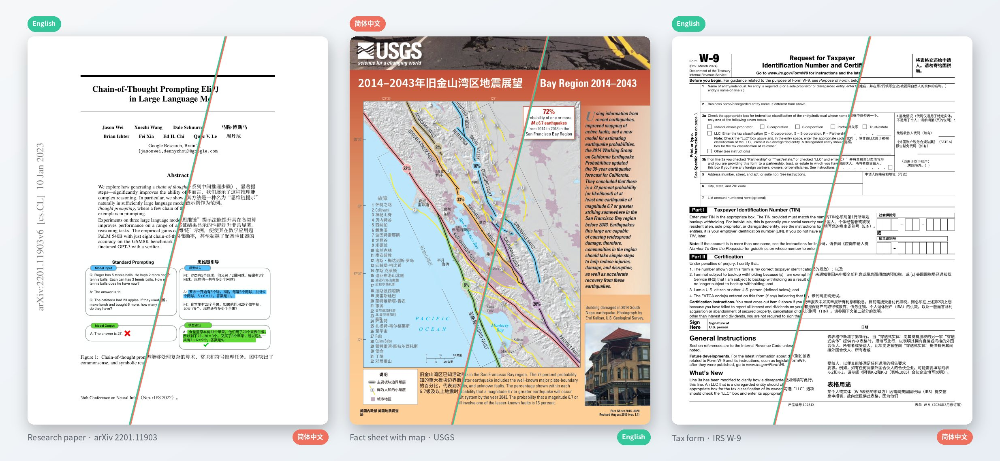
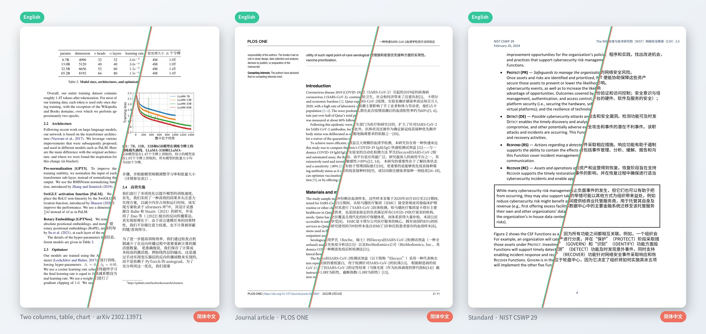

<div align="center">

<picture>
  <source media="(prefers-color-scheme: dark)" srcset="brand/logo-horizontal-dark.svg">
  <source media="(prefers-color-scheme: light)" srcset="brand/logo-horizontal-light.svg">
  
</picture>

### Translate a PDF. Keep the page.

PATT-PDF puts the Chinese translation where the English text was,<br>
and leaves figures, tables, rules and numbers in place.

[](docs/STATUS.md)
[](https://github.com/SPIRAL-EDWIN/PATT-pdf/actions/workflows/tests.yml)
[](pyproject.toml)
[](docs/INSTALL.md)
[](docs/INSTALL.md)
[](LICENSE)

**English** · [简体中文](README.zh-CN.md)

[Install](#install) · [Use](#use) · [Results](#how-well-does-it-work) · [Limits](#limits) · [Docs](#documentation)

<picture>
  <source media="(prefers-color-scheme: dark)" srcset="docs/showcase/hero-dark.jpg">
  <source media="(prefers-color-scheme: light)" srcset="docs/showcase/hero-light.jpg">
  
</picture>

<sub>Real pages, translated with DeepL, unedited. Each page is split along a diagonal between the original and the PATT-PDF output.<br>
By PATT's own checks the paper and the form pass; the map page does not, because the text inside its images is left in English. <a href="#sample-pages">Sources and licences</a></sub>

</div>

## Install

macOS and Linux, one command:

```bash
curl -fsSL https://raw.githubusercontent.com/SPIRAL-EDWIN/PATT-pdf/main/install.sh | bash
```

The installer works in five numbered steps and shows what each one downloads, how much, and its progress. It installs into its own folder and ends with a self-check.

- **Fast in mainland China.** Downloads go through the Tsinghua TUNA mirrors by default. The installer says so first and lets you switch to the official sources (or pass `--mirror official`).
- **Asks before it changes your system.** On a Mac without Homebrew it asks before installing Homebrew.
- **Uses what you have.** Fonts that are already installed are not downloaded again; `uv` is used when present.

Details, manual steps and uninstall: [docs/INSTALL.md](docs/INSTALL.md).

## Use

```bash
export DEEPL_AUTH_KEY=...            # your own DeepL API key

patt-pdf run paper.pdf               # shows the character count and asks before sending
patt-pdf run paper.pdf --pages 1-3   # try a few pages first: 7   7-9   7,9   1-3,7,10-
patt-pdf run ./papers --out ./zh --max-chars 20000 --yes      # for scripts
```

Translated PDFs go to `./translated`, and the terminal shows one line per file:

```text
pass    form.pdf    1 page                                                             → translated/form.pdf
fail    paper.pdf   2 pages: 1 pass · 1 fail  a number or URL differs from the source  → translated/paper.pdf
```

Your PDFs are never written to. Nothing is sent before you confirm, and never more than `--max-chars`. With `--pages` the output keeps every page and only the selected ones are translated. Each step also exists as its own command (`plan`, `estimate`, `translate`, `render`, `report`, `compare`, `publish`): see the [reference](docs/REFERENCE.md).

## What you get

| | |
|---|---|
| **The page stays** | Text is replaced in its own box. Images, charts, table rules and page numbers are not redrawn; links are kept. |
| **Numbers are checked** | Every figure in the source must appear in the translation. On the sample pages this caught DeepL turning `62B` into `62亿`. |
| **A report, not a promise** | Each page is rated `pass`, `review` or `fail` with the reason, so you know where to look. |
| **Your budget** | An estimate first, a hard character cap, and a cache so nothing is paid twice. |
| **Offline when needed** | Planning, layout tests and hand-made translations need no network. OCR runs locally and only on pages that need it. |

## How well does it work?

Fourteen pages from seven public documents, translated with DeepL and rated by PATT's own checks:

| Document | Pages | Result | Why not all pass |
|---|:---:|---|---|
| Research paper with figures · arXiv 2201.11903 | 2 | 1 pass · 1 fail | DeepL changed a figure (`62B` → `62亿`) |
| Two-column paper with tables and charts · arXiv 2302.13971 | 3 | 2 review · 1 fail | link areas to check; one figure differs from the source |
| Journal article · PLOS ONE | 3 | 2 review · 1 fail | link areas to check; a footnote mark was redrawn |
| Standard with diagrams · NIST CSWP 29 | 2 | 1 review · 1 fail | text inside an image stays English |
| Tax form · IRS W-9 | 1 | 1 pass | |
| Fact sheets with maps and photos · USGS | 3 | 3 fail | text inside images stays English |

A `fail` usually means one item on the page needs a look, not that the page is unusable. A `pass` means the checks found nothing; it does not prove the translation is right. Compare with the original before you rely on a page.

<sub>Measured with v0.4.0.dev0 on Linux. What was run on which machine, and what was not, is listed in [docs/STATUS.md](docs/STATUS.md).</sub>

## Limits

PATT-PDF is experimental. Today it does not do the following:

- **Languages:** English → Simplified Chinese only.
- **Images:** text inside images stays English (and is reported).
- **Curved text:** labels that follow a curve, as on maps, stay English.
- **Styles:** italics and link colours inside a paragraph are lost.
- **Tables and formulas:** table cells are translated in place but not re-flowed; formulas can break.
- **Interface:** command line only.
- **Platforms:** checked on Linux (aarch64) and on one Apple Silicon Mac, including a full install through Homebrew. Not verified: Intel Macs, a Mac without Homebrew, Fedora/Arch/openSUSE packages. Windows is maintained separately.

## Privacy and cost

The work folder stores source text and translations in plain text. DeepL receives the text you translate and decides the bill. Read [DeepL, privacy and cost](docs/REFERENCE.md#deepl-key-cost-and-privacy) first.

## Documentation

[Install](docs/INSTALL.md) · [Reference](docs/REFERENCE.md) · [Status and verification](docs/STATUS.md) · [Changes](CHANGELOG.md) · [Architecture](docs/ARCHITECTURE.md) · [Contributing](CONTRIBUTING.md) · [Security](SECURITY.md)

```bash
python -m pip install -e '.[dev]' && python -m pytest -q      # development
```

## Sample pages

<picture>
  <source media="(prefers-color-scheme: dark)" srcset="docs/showcase/more-dark.jpg">
  <source media="(prefers-color-scheme: light)" srcset="docs/showcase/more-light.jpg">
  
</picture>

The pictures are made with `tools/diagonal_compare.py` from these documents; the documents themselves are not in the repository.

- Wei et al., *Chain-of-Thought Prompting Elicits Reasoning in Large Language Models*, [arXiv:2201.11903](https://arxiv.org/abs/2201.11903), CC BY 4.0.
- Touvron et al., *LLaMA: Open and Efficient Foundation Language Models*, [arXiv:2302.13971](https://arxiv.org/abs/2302.13971), CC BY 4.0.
- Coyle et al., [PLOS ONE 17(1): e0262897](https://doi.org/10.1371/journal.pone.0262897), CC BY 4.0.
- U.S. Geological Survey Fact Sheet 2016–3020; NIST CSWP 29; IRS Form W-9: works of the U.S. government.

The Chinese text in the pictures is machine translation produced by this tool. It is a modified version of the originals and is not endorsed by their authors.

## License

[AGPL-3.0-or-later](LICENSE). PATT-PDF builds on PyMuPDF/MuPDF (AGPL or commercial). Dependencies and fonts: [third-party notices](THIRD_PARTY_NOTICES.md).
