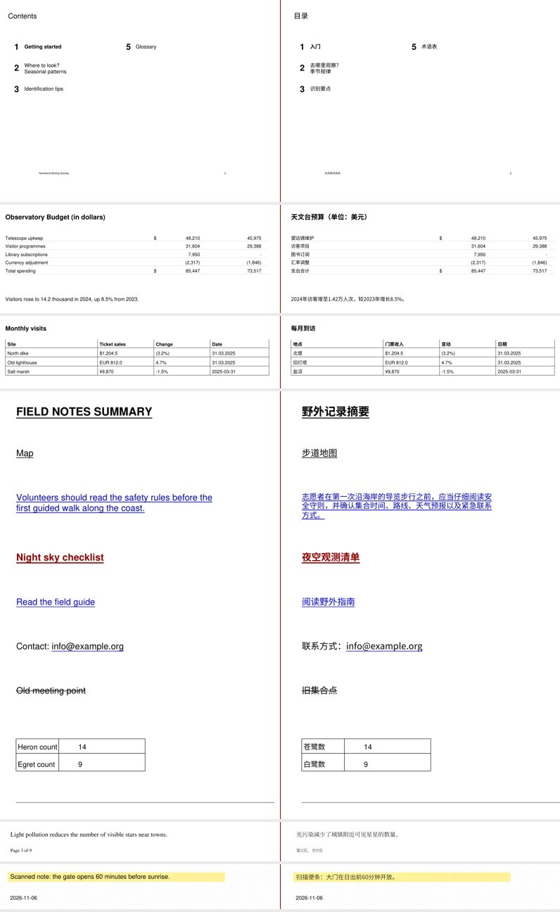

<div align="center">

# PATT-PDF

**Position-Aware Translation Toolkit for PDF**

Translate English PDFs into Simplified Chinese, with the translated text placed as close as possible to its original position.

[English](README.md) · [简体中文](README.zh-CN.md)

[Preview](#preview) · [Install](#install) · [Quick start](#quick-start) · [Documentation](#documentation)

</div>

> **Experimental · v0.3.7.dev0.** This is a command-line prototype, not a finished desktop app. Current focus: macOS and Linux. This version has been tested offline on synthetic PDFs on Linux only; it has not yet run in CI or on a Mac, and Windows machine tests are on hold. Nothing has been verified on real-world PDFs or with a real DeepL request. Results can be incomplete or inaccurate: always review the output. See [platform status](docs/STATUS.md).

## Preview

<p align="center">
  
</p>

*Original on the left · translated output on the right. These are synthetic test pages using fixed translations, not a real-world or DeepL benchmark. The image combines several page types; it does not imply every page passes QA. See the [sample report](docs/sample/REPORT_SAMPLE.md).*

## What PATT does

- **Position-aware replacement:** extracts text and tries to place the translation in the original area while preserving surrounding graphics, numbers and other protected content.
- **Reviewable workflow:** plans pages, estimates translation volume, renders output, and produces QA reports and side-by-side images.
- **Choice of translation backend:** DeepL API, an offline manual translation memory, or a pseudo backend for layout testing. PATT is a workflow, not a translation model.
- **Input protection:** keeps source files separate from working state and published output; publishing does not overwrite existing files.
- **Experimental OCR:** handles some scanned and outlined-text pages with optional local Tesseract. Images containing text are not translated.

Currently only English → Simplified Chinese is supported. Complex layouts, tables, scans, formulas and other real documents may not be faithfully reproduced. There is no GUI, LLM backend, or platform-specific installer yet. See [capabilities and limitations](docs/REFERENCE.md#what-it-does-and-how-well).

## Install

Choose your system to see the source installation steps. All systems use the same Python package; there are no downloadable OS-specific builds yet. Python 3.10 or newer is required; 3.10–3.13 are the intended test range. Install Git and Python first. For the Chinese fonts below, install the Noto Sans CJK SC and Noto Serif CJK SC regular and bold faces. OCR additionally requires Tesseract with English data and the Python `[ocr]` extra.

<details>
<summary><b>macOS</b></summary>

Install the fonts with Homebrew, or obtain the static SC OTF files from [Noto CJK releases](https://github.com/notofonts/noto-cjk/releases). For OCR, also install Tesseract.

```bash
brew install --cask font-noto-sans-cjk font-noto-serif-cjk
# Optional for scanned / outlined pages:
brew install tesseract

git clone https://github.com/SPIRAL-EDWIN/PATT-pdf.git
cd PATT-pdf
python3 -m venv .venv
source .venv/bin/activate
python -m pip install .          # use '.[ocr]' for OCR
patt-pdf fonts
patt-pdf doctor
```

</details>

<details>
<summary><b>Windows</b></summary>

Install the static SC OTF fonts from [Noto CJK releases](https://github.com/notofonts/noto-cjk/releases) for your user, or keep them in a folder and set `PATT_PDF_FONT_SOURCE`. For OCR, install the [Tesseract build](https://github.com/UB-Mannheim/tesseract/wiki) with English data. In PowerShell:

```powershell
git clone https://github.com/SPIRAL-EDWIN/PATT-pdf.git
cd PATT-pdf
py -3 -m venv .venv
.\.venv\Scripts\Activate.ps1
python -m pip install .          # use '.[ocr]' for OCR
patt-pdf fonts
patt-pdf doctor
```

If the Python launcher is unavailable, use `python -m venv .venv`. Use a short path such as `C:\patt` if Windows long paths are disabled; if `pip install` fails with a missing temporary file or "file already exists", `python tools\install_check.py --source . --work C:\pt` retries from a clean copy in a short new folder (it never deletes anything). OCR dependencies may not be available for every Python/CPU combination, including Windows ARM; check `doctor` and the [platform notes](docs/STATUS.md).

For privacy, `install_check.py` suppresses pip's output and reports its exit code.
This does not control pip's own file logging, configuration, environment, or
process arguments: avoid placing credentials in command arguments, `PIP_LOG`,
`--log`, or shared configuration, and inspect private logs before sharing.

</details>

<details>
<summary><b>Linux (Debian / Ubuntu)</b></summary>

```bash
sudo apt install fonts-noto-cjk python3-venv
# Optional for scanned / outlined pages:
sudo apt install tesseract-ocr tesseract-ocr-eng

git clone https://github.com/SPIRAL-EDWIN/PATT-pdf.git
cd PATT-pdf
python3 -m venv .venv
source .venv/bin/activate
python -m pip install .          # use '.[ocr]' for OCR
patt-pdf fonts
patt-pdf doctor
```

</details>

`patt-pdf fonts` copies locally available fonts into a per-user directory; it does not download them. `doctor` reports detected fonts, Tesseract and environment warnings. If `patt-pdf` cannot even start (for example an editable install from a non-ASCII folder on Python 3.11 with a non-UTF-8 locale), run `python -S tools/preflight.py` with the same Python: it needs only the standard library, prints no local paths by default, and suggests a recovery. See [font and installation details](docs/REFERENCE.md#install) for custom paths and encoding caveats.

## Quick start

Put a PDF or a folder of PDFs at `./in`. Keep `./work` outside the input folder: it contains private working data. The following uses DeepL and sends translatable text to its API. Set `DEEPL_AUTH_KEY` in your environment first; API use may incur charges. Start with a small, non-sensitive sample.

```bash
patt-pdf plan      ./in --state ./work
patt-pdf estimate  ./in --state ./work --backend deepl
# Choose a budget after reviewing the estimate:
patt-pdf translate ./in --state ./work --backend deepl --max-chars 10000 --yes
patt-pdf render    ./in --state ./work --backend deepl
patt-pdf report    ./in --state ./work --out report.md
patt-pdf compare   ./in --state ./work --out ./comparison
patt-pdf publish   ./in --state ./work --dest ./translated --suffix " zh-Hans"
```

Review the report and comparison images before using the result. `publish` copies only files with `pass` status by default; a pass means no automated check found a problem, not that the translation is guaranteed correct. To use fixed translations without a network request, see the [manual backend example](docs/REFERENCE.md#quick-start-offline-no-api). Keep backend, manual translation memory and glossary options consistent across `estimate`, `translate` and `render`.

**Privacy and cost:** the state directory stores source text and translations in plain text. DeepL receives translatable text; its billing is determined by DeepL, including potentially processed requests whose outcome is unknown. The budget and quota checks do not guarantee the billed amount. Read [DeepL, privacy and cost](docs/REFERENCE.md#deepl-key-cost-and-privacy) before use.

## Documentation

- [Detailed reference](docs/REFERENCE.md) — installation, backends, QA statuses, exit codes, privacy and platform history
- [Current status and verification](docs/STATUS.md) · [Architecture](docs/ARCHITECTURE.md) · [Migration](docs/MIGRATION.md)

## Development

```bash
python -m pip install -e '.[ocr,dev]'
python -m pytest -q
```

Tests run offline on synthetic fixtures; OCR tests require Tesseract. See the [editable-install caveats](docs/REFERENCE.md#install), especially for non-ASCII paths and older Python environments.

## License

[AGPL-3.0-or-later](LICENSE). PATT-PDF uses PyMuPDF/MuPDF, available under AGPL or a commercial license. See [third-party notices](THIRD_PARTY_NOTICES.md) for dependencies, fonts and acknowledgements.
