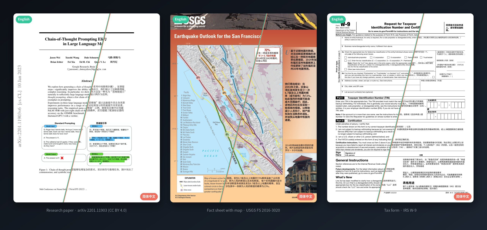
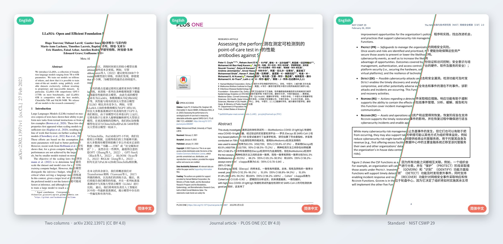

<div align="center">

<picture>
  <source media="(prefers-color-scheme: dark)" srcset="brand/logo-horizontal-dark.svg">
  <source media="(prefers-color-scheme: light)" srcset="brand/logo-horizontal-light.svg">
  
</picture>

### 翻译 PDF，版面不动。

PATT-PDF 把中文译文放回英文原来的位置，<br>
图片、表格、线条和数字都留在原处。

[](docs/STATUS.md)
[](pyproject.toml)
[](docs/INSTALL.zh-CN.md)
[](docs/INSTALL.zh-CN.md)
[](LICENSE)

[English](README.md) · **简体中文**



</div>

<sub>真实页面，DeepL 翻译，未经修饰。每页左上是原文，右下是 PATT-PDF 的输出。按 PATT 自己的检查，论文页和表格页为 `pass`，地图页为 `fail`：图片里的文字不翻译，沿曲线排列的标注保留英文。[来源与许可](#示例页面)。</sub>

## 安装

macOS 与 Linux，一行命令：

```bash
curl -fsSL https://raw.githubusercontent.com/SPIRAL-EDWIN/PATT-pdf/main/install.sh | bash
```

脚本分五步进行，每一步显示下载量和进度，装进自己的独立目录，最后自检。默认通过国内镜像（清华 TUNA）下载；脚本会先说明并询问，你可以改用官方源，或直接加 `--mirror official`。Mac 上如果没有 Homebrew，会先征得你同意再安装。详细说明、手动安装与卸载见 [docs/INSTALL.zh-CN.md](docs/INSTALL.zh-CN.md)。

## 使用

```bash
export DEEPL_AUTH_KEY=...            # 你自己的 DeepL API 密钥

patt-pdf run paper.pdf               # 先显示字符数，确认后才发送
patt-pdf run paper.pdf --pages 1-3   # 先试几页：7   7-9   7,9   1-3,7,10-
patt-pdf run ./papers --out ./zh --max-chars 20000 --yes      # 脚本用
```

译文 PDF 放在 `./translated`，终端里每个文件一行：

```text
pass    form.pdf    1 页                                          → translated/form.pdf
fail    paper.pdf   2 页：1 pass · 1 fail  数字或网址与原文不一致  → translated/paper.pdf
```

工具不会写入你的 PDF。确认之前不发送任何内容，发送量也不会超过 `--max-chars`。使用 `--pages` 时输出仍是整本文档，只有选中的页被翻译。每一步也可以单独执行（`plan`、`estimate`、`translate`、`render`、`report`、`compare`、`publish`），见[参考文档](docs/REFERENCE.md)。

## 你能得到什么

| | |
|---|---|
| **版面保留** | 文字在自己的框里替换。图片、图表、表格线和页码不重画，链接保留。 |
| **数字核对** | 原文里的每个数字都必须出现在译文里。示例页面中，它查出 DeepL 把 `62B` 译成了 `62亿`。 |
| **给报告，不打包票** | 每页标为 `pass`、`review` 或 `fail` 并说明原因。默认只发布 `pass` 的文件。 |
| **预算由你定** | 先估算，再设字符上限；有缓存，同一句不会付两次钱。 |
| **可以离线** | 页面分析、版面测试和人工译文都不需要联网。OCR 在本机运行，只在需要的页面上调用。 |

## 实际效果如何？

7 份公开文档共 14 页的结果（DeepL，v0.4.0.dev0，Linux），按 PATT 自己的检查评定：

| 文档 | 页数 | 结果 | 未全部通过的原因 |
|---|---|---|---|
| 带图的论文（arXiv 2201.11903） | 2 | 1 pass · 1 fail | DeepL 改了一个数字（`62B` → `62亿`） |
| 双栏论文，含表格和图表（arXiv 2302.13971） | 3 | 2 review · 1 fail | 链接区域需核对；一处数字与原文不同 |
| 期刊文章（PLOS ONE） | 3 | 2 review · 1 fail | 链接区域需核对；一个脚注标记被重画 |
| 带示意图的标准文件（NIST CSWP 29） | 2 | 1 review · 1 fail | 图片里的文字仍是英文 |
| 税务表格（IRS W-9） | 1 | 1 pass | |
| 带地图和照片的科普单页（USGS） | 3 | 3 fail | 图片里的文字仍是英文 |

`fail` 通常表示这一页有一处需要人看，不等于整页不能用。`pass` 表示检查没有发现问题，不保证译文正确。使用前请对照原文。完整记录见 [docs/STATUS.md](docs/STATUS.md)。

**目前还做不到：** 只支持英文 → 简体中文 · 图片里的文字不翻译 · 沿曲线排列的文字（地图标注）保留英文 · 行内斜体和链接颜色会丢失 · 公式可能出错 · 表格按单元格翻译但不重排 · 没有图形界面 · 目前只在 Linux 上验证过，macOS 核查待完成，Windows 由协作者单独维护。

## 隐私与费用

工作目录以明文保存原文和译文。DeepL 会收到待翻译文本，费用由 DeepL 决定。使用前请阅读 [DeepL、隐私与费用说明](docs/REFERENCE.md#deepl-key-cost-and-privacy)。

## 文档

[安装](docs/INSTALL.zh-CN.md) · [参考文档](docs/REFERENCE.md) · [状态与验证](docs/STATUS.md) · [架构](docs/ARCHITECTURE.md)

```bash
python -m pip install -e '.[dev]' && python -m pytest -q      # 开发
```

## 示例页面



图片由 `tools/diagonal_compare.py` 根据下列文档生成；文档本身不在仓库中。

- Wei 等，*Chain-of-Thought Prompting Elicits Reasoning in Large Language Models*，[arXiv:2201.11903](https://arxiv.org/abs/2201.11903)，CC BY 4.0。
- Touvron 等，*LLaMA: Open and Efficient Foundation Language Models*，[arXiv:2302.13971](https://arxiv.org/abs/2302.13971)，CC BY 4.0。
- Coyle 等，[PLOS ONE 17(1): e0262897](https://doi.org/10.1371/journal.pone.0262897)，CC BY 4.0。
- 美国地质调查局 Fact Sheet 2016–3020、NIST CSWP 29、IRS W-9 表格：美国政府作品。

图片中的中文是本工具生成的机器翻译，属于对原作的修改，未经原作者认可。

## 许可证

[AGPL-3.0-or-later](LICENSE)。PATT-PDF 基于 PyMuPDF/MuPDF（AGPL 或商业许可）。依赖与字体见[第三方声明](THIRD_PARTY_NOTICES.md)。
